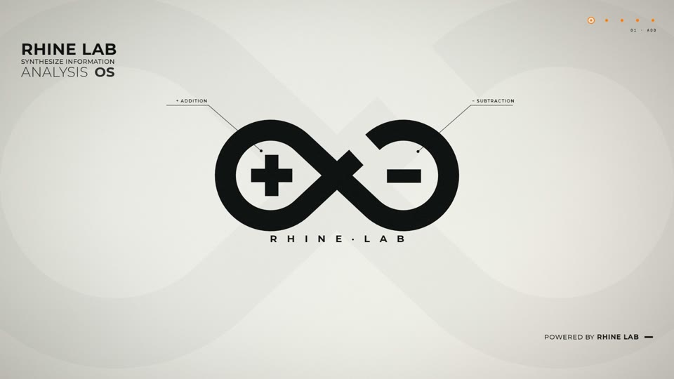
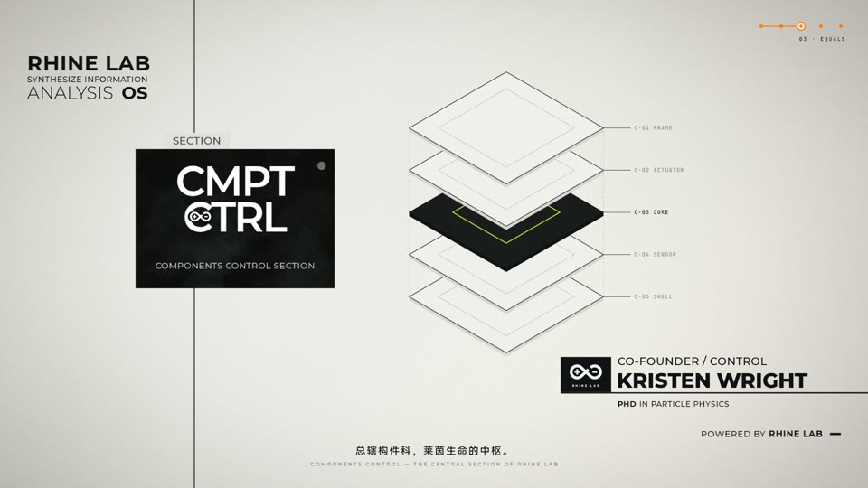
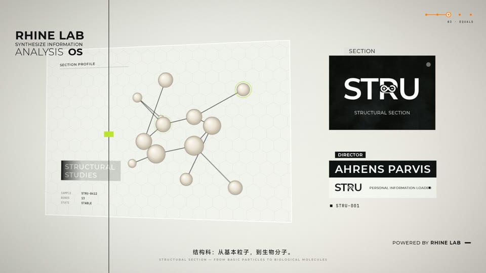
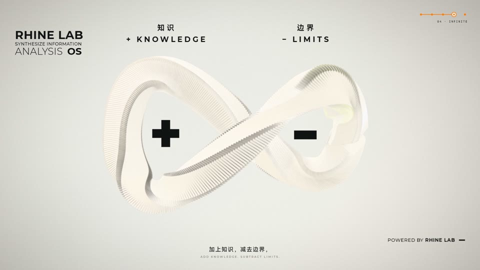
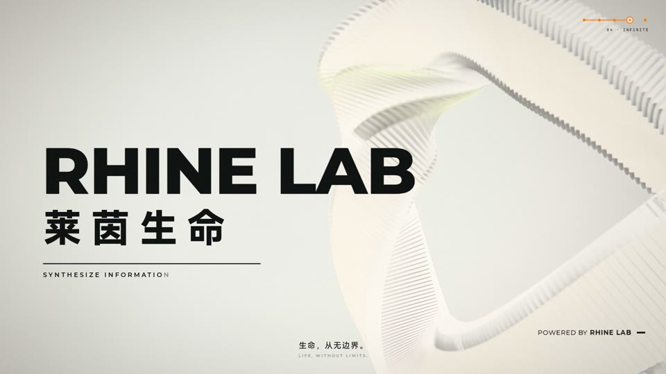
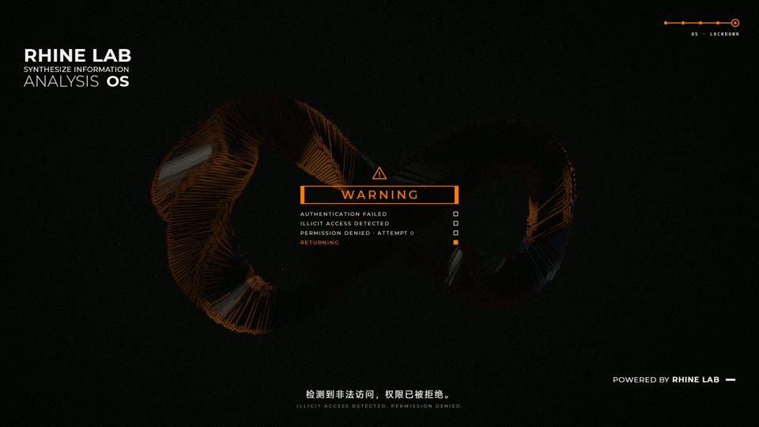

# 莱茵生命 · RHINE LAB —「＋ − ＝ ∞」

《明日方舟》莱茵生命的同人宣传短片（62.5 秒，1080p30）。整部片子是代码：每个镜头都是“时间 → 画面”的纯函数，用 three.js + Canvas2D 在浏览器里逐帧离线渲染，再由 ffmpeg 合成。

*An Arknights Rhine Lab fan promo (62.5 s, 1080p30) written as code: every shot is a pure function of time, rendered offline frame by frame with three.js + Canvas2D in headless Chromium. English summary at the end.*

| | | |
|---|---|---|
|  |  |  |
|  |  |  |

## 构思

莱茵生命的标志里，左环是 **＋**，右环是 **−**。短片把这个几何形状当成论点：

| 段落 | 小节 | 内容 |
|---|---|---|
| 冷开场 | 0 | 信号 → ＋、− 砸入 → ∞ 围着它们画出来 |
| ＋ 加法 | 1–4 | 每一次实验，都是一次加法：档案落成一摞、＋ 阵列成倍增殖、记录计数器、档案行 |
| − 减法 | 5–8 | 每一次突破，都减去一道边界：卡片墙剥落、LIMIT 被划掉、约束清单被涂黑、不可能 − 不 ＝ 可能 |
| ＝ 等于 | 9–16 | ＝ 砸合再分开、科室星图、六个科室（部门牌在科室之间穿行）、人员档案 |
| ∞ 无限 | 17–22 | 400 片鳍的 ∞ 雕塑组装，一条连续的机位贯穿特写、论点、服务科室标注和品牌镜头 |
| 入侵 | 22–25 | 比对授权 → 机密档案 C-023 → 封锁 WARNING（配乐转闷） |
| 收尾 | 25–28 | 返回公共频道 → 雕塑散开 → 标志落定 |

配乐是 112 BPM 的「Rhine Lab.LLC」，剪辑全部卡在拍点上；音乐用了 A 段，再从第 16 小节接 C/D/E 段，拼接点和弦一致。

## 实现

```
film/
  src/engine/   stage3d.js    实例化卡片阵型（∞ 带 / 档案行 / 墙 / 螺旋 / 堆叠，可相互变形）、N8AO、景深、调色
                compositor.js 纸面、2D 图层、透视卡片、故障/撕裂、转场混合、子帧累积
                engine.js     每帧取 N 个抖动子帧（运动模糊 + 抗锯齿）；切点处同时渲染前后两个镜头做转场
  src/hud.js    贯穿全片的界面层：抬头、步骤指示、页脚、字幕、在科室间穿行的部门牌
  src/shots/    act1–4.js，每个镜头一个纯函数
  src/lib/      节拍网格与缓动、整套 2D 视觉语汇（draw.js）、单应性变换
  tools/        render.mjs 离线渲染 · sfx.py 合成音效 · mix.py 配乐剪辑与混音（−14 LUFS）
                sheet.sh 接触印样 · lookdev.mjs/tune.sh 调光 · analyze_bgm.py 节拍分析
```

## 构建

需要：Node.js、ffmpeg、Python 3（numpy）、能用 GPU 的 Chromium（Playwright 自带）。

```sh
cd film && npm i && npx playwright install chromium
npx vite --host 127.0.0.1 --port 5180 --strictPort &      # 渲染服务

node tools/render.mjs --still 22.9,46.3 --out ../out/stills         # 单帧
./tools/sheet.sh 19.29 27.86 4 3 act2                              # 接触印样
node tools/render.mjs --from 0 --to 62.5 --scale 2.5 --out ../out/video.mp4 --crf 8

node tools/cues.mjs ../out/cues.json                                # 从时间线导出音效点
python3 tools/sfx.py                                                # 生成音效
RHINE_BGM=/path/to/779491.wav python3 tools/mix.py ../out/cues.json ../out/mix.wav
ffmpeg -i ../out/video.mp4 -i ../out/mix.wav -map 0:v -map 1:a -c:v copy -c:a aac -b:a 320k ../out/RhineLab_Promo.mp4
```

### 仓库里没有的东西

- **配乐**「Rhine Lab.LLC」（孤星 OST，© Hypergryph / 塞壬唱片）：请自备，用环境变量 `RHINE_BGM` 指向文件，或放到 `film/audio/bgm/779491.wav`。
- **MiSans**（中文字体）：不再分发。可从小米官方下载后放进 `film/public/fonts/`（`MiSans-Regular/Medium/Semibold/Bold.ttf`）；没有时会自动用系统里的思源黑体 / Noto Sans CJK 等代替。
- **官方 PV 和截帧**：只作为参考，不收录。

## 素材与致谢

- 代码：GNU AGPL-3.0（[LICENSE](LICENSE)）。
- 字体：Montserrat、JetBrains Mono，SIL Open Font License 1.1（见 `film/public/fonts/OFL-*.txt`）。
- 贴图（`film/public/tex/`）与 `film/audio/reuse/` 里的合成音效来自作者的莱茵生命锁屏项目，由脚本生成；`glitch1/2`、`recover` 来自 Kenney *Interface Sounds*（CC0）。详见 `film/audio/reuse/README.md`。
- 视觉参考：《明日方舟》特别映像《莱茵生命：访问》。∞ 标志是对照官方影片描摹的同人重绘。
- 本项目由 Claude（Anthropic）在 Claude Code 中编写。

## 声明

这是同人作品，与 Hypergryph / 鹰角网络无关，也未获其认可。《明日方舟》、莱茵生命及相关名称、角色、标志的权利归其各自所有者。AGPL 只覆盖本仓库的原创代码，不授予任何第三方知识产权。

---

## English summary

A fan promo for Arknights' Rhine Lab. The mark's left loop holds a **＋** and its right loop a **−**; the film turns that into its thesis: *add knowledge, subtract limits, equals infinite*. It is cut to the 112 BPM grid of "Rhine Lab.LLC".

Everything is code (`film/`): an offline engine that averages 12–40 jittered sub-frames per frame (motion blur + AA), renders both shots across a cut to blend them with transition shaders, and lays one continuous HUD layer (header, step indicator, subtitles, a travelling section tile) over the picture. The ∞ sculpture is one instanced draw call whose formations morph into one another. Sound effects are synthesised by `tools/sfx.py`, and `tools/mix.py` edits the score and masters to −14 LUFS.

Not included: the score (bring your own, `RHINE_BGM=…`), the MiSans font (optional, falls back to a system CJK font), and the official PV. Code is AGPL-3.0; fonts are OFL. This is an unofficial fan work, not affiliated with or endorsed by Hypergryph.
